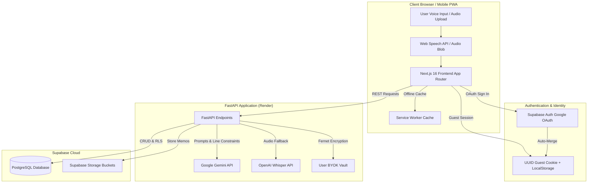

<div align="center">

  <h1>🎙️ Yarn (VoiceLog)</h1>
  <p><strong>Speak your day. Fit your paper logbook's exact lines.</strong></p>
  <p>An offline-first voice-to-text logbook assistant purpose-built for Nigerian university and polytechnic students on industrial training.</p>

  <p>
    <a href="https://yarn-voicelog.vercel.app"><strong>Explore Live Web App »</strong></a>
    <br />
    <br />
    <a href="#-key-features">Key Features</a> •
    <a href="#-architecture">Architecture</a> •
    <a href="#-tech-stack">Tech Stack</a> •
    <a href="#-getting-started">Getting Started</a> •
    <a href="DEPLOYMENT.md">Deployment Guide</a>
  </p>

  <p>
    
    
    
    
    
    
    
  </p>
</div>

---

## 💡 The Problem & The Solution

Every year, hundreds of thousands of Nigerian university and polytechnic students across institutions (such as **OAU**, **UNILAG**, **FUTA**, **UNN**, and polytechnics) undergo mandatory industrial attachments:
* **SWEP (200L):** Departmental practicals and workshop tasks.
* **SIWES (300L):** Introductory industrial exposure.
* **IT (400L):** 6-month specialized professional training.

### The Problem
* **Rigid Physical Margins:** Physical logbooks printed by the Industrial Training Fund (ITF) and universities feature strict daily blank lines (usually 2 to 6 lines per day).
* **Generic AI Fails:** Standard chatbots generate bloated 5-paragraph academic essays using robotic passive voice (*"The valve was inspected by the team..."*). Students cannot fit these into their physical booklets without getting flagged or reprimanded by coordinators.
* **Workplace Realities:** Workshop days are tiring, cellular connectivity is often spotty, and tasks are discussed in authentic Nigerian English, technical jargon, or workshop slang (*"we loss the pump"*, *"follow oga go site"*).

### The Solution: Yarn
**Yarn** lets students speak for 30 seconds about their day in plain English or local workshop lingo. Powered by **Google Gemini** and calibrated constraints, Yarn converts raw audio or transcripts into tight, active first-person sentences (*"I inspected the centrifugal pump..."*, *"We completed the pressure test under supervision"*), strictly fitting the exact ruled line limit of their booklet.

---

## ✨ Key Features

- 📐 **Strict Physical Line Limits:** Calibrated presets for **SWEP** (5–6 lines), **SIWES** (2–3 lines), and **IT** (2–4 lines), with custom line overrides to match any physical booklet.
- 🗣️ **Nigerian Workplace Lingo Support:** Accurately translates real site and workshop terms into professional technical logbook language without losing context.
- 👤 **Active First-Person Voice:** Produces authentic entries using personal pronouns ("I" and "We") preferred by industrial coordinators, never passive academic filler.
- 📴 **Offline-First PWA:** Installable on Android, iOS, and Desktop with Service Worker background caching so students can record entries without internet.
- ⚡ **Zero-Friction Guest Mode + Google Sync:** Students can start instantly without signing up. When they sign in with Google later, all existing guest entries automatically migrate to their permanent account.
- 🔒 **Confidentiality / NDA Mode:** Toggle to restrict and redact raw audio or proprietary plant details for intellectual property protection.
- 📄 **One-Click Word (.docx) & PDF Export:** Export weekly log sheets formatted with official ITF supervisor signing boxes for seamless end-of-training defense submission.

---

## 🏗️ Architecture



---

## 🛠️ Tech Stack

| Layer | Technology | Details |
|---|---|---|
| **Frontend** | [Next.js 16](https://nextjs.org/) (App Router) | React 19, Tailwind CSS, Lucide Icons, Turbopack |
| **PWA** | Service Workers + Web Manifest | Offline recording, installable on mobile & desktop |
| **Backend** | [FastAPI](https://fastapi.tiangolo.com/) (Python 3.10) | Uvicorn, Pydantic, Python-docx, ReportLab (PDF) |
| **AI / LLM** | [Google Gemini](https://ai.google.dev/) | `gemini-1.5-flash` / `gemini-2.0-flash` inference |
| **Speech-to-Text** | Web Speech API + Whisper | Browser-native speech recognition with Whisper API fallback |
| **Database & Auth**| [Supabase](https://supabase.com/) | PostgreSQL with Row Level Security (RLS), Supabase Auth |
| **Security** | Cryptography (Fernet) | Symmetric encryption for optional BYOK API keys |
| **Deployment** | [Vercel](https://vercel.com/) + [Render](https://render.com/) | Edge frontend hosting and cloud Python web service |

---

## 🚀 Getting Started

### Prerequisites
* **Node.js** 18.18+ or 20+
* **Python** 3.10+
* **Google Gemini API Key** (Free tier available on [Google AI Studio](https://aistudio.google.com/apikey))
* **Supabase Project** (Free tier available on [supabase.com](https://supabase.com/))

---

### 1. Clone Repository

```bash
git clone https://github.com/Ayosensei/yarn-voicelog.git
cd yarn-voicelog
```

---

### 2. Backend Setup

```bash
# Navigate to backend directory
cd backend

# Create and activate virtual environment
python3 -m venv venv
source venv/bin/activate  # On Windows: venv\Scripts\activate

# Install dependencies
pip install -r requirements.txt

# Configure environment variables
cp .env.example .env
```

Open `backend/.env` and fill in your keys:
```env
GEMINI_API_KEY=your_gemini_api_key
SUPABASE_URL=https://your-project.supabase.co
SUPABASE_KEY=your_supabase_service_role_or_anon_key
FRONTEND_URL=http://localhost:3000
```

Start the backend server:
```bash
uvicorn main:app --reload --host 0.0.0.0 --port 8000
```
Verify the backend is live at `http://localhost:8000/health`.

---

### 3. Frontend Setup

In a new terminal window:

```bash
# Navigate to frontend directory
cd frontend

# Install npm dependencies
npm install

# Configure environment variables
cp .env.example .env.local
```

Open `frontend/.env.local` and set your URLs:
```env
NEXT_PUBLIC_API_URL=http://localhost:8000
NEXT_PUBLIC_SUPABASE_URL=https://your-project.supabase.co
NEXT_PUBLIC_SUPABASE_ANON_KEY=your_supabase_anon_key
```

Start the Next.js development server:
```bash
npm run dev
```

Open [http://localhost:3000](http://localhost:3000) in your browser.

---

### 4. Database Setup (Supabase)

1. Open your Supabase Project's **SQL Editor**.
2. Run the SQL schema scripts located in [`database/`](database/):
   - [`01_schema.sql`](database/01_schema.sql) — Core users, logs, and vocabulary tables.
   - [`02_training_programs.sql`](database/02_training_programs.sql) — Program metadata (SWEP, SIWES, IT).
   - [`03_onboarding.sql`](database/03_onboarding.sql) — Student profile onboarding fields.
   - [`04_grammar_and_faculty.sql`](database/04_grammar_and_faculty.sql) — Grammar levels & Nigerian lingo toggle.
3. In **Storage**, create a private bucket named `voice-memos` with a 10MB limit.

---

## 🔑 Environment Variables Reference

### Backend (`backend/.env`)

| Variable | Description |
|---|---|
| `GEMINI_API_KEY` | Google Gemini API key for logbook formatting |
| `SUPABASE_URL` | Supabase project API URL |
| `SUPABASE_KEY` | Supabase `service_role` or `anon` key |
| `FRONTEND_URL` | Allowed origin for CORS in production |
| `OPENAI_API_KEY` | *(Optional)* For Whisper audio upload fallback |
| `FERNET_SECRET_KEY` | *(Optional)* 32-byte base64 key for encrypting user BYOK keys |

### Frontend (`frontend/.env.local`)

| Variable | Description |
|---|---|
| `NEXT_PUBLIC_API_URL` | URL of the deployed or local FastAPI backend |
| `NEXT_PUBLIC_SUPABASE_URL` | Public Supabase project URL |
| `NEXT_PUBLIC_SUPABASE_ANON_KEY` | Public Supabase anonymous client key |

---

## 📁 Repository Structure

```text
yarn-voicelog/
├── backend/
│   ├── app/                # Application modules
│   ├── services/           # LLM, STT, and export services
│   ├── tests/              # Pytest test suite
│   ├── config.py           # Settings and environment loader
│   ├── main.py             # FastAPI entrypoint and routes
│   ├── models.py           # Pydantic schemas
│   └── requirements.txt    # Python dependencies
├── frontend/
│   ├── public/             # PWA icons, manifest, service worker
│   ├── src/
│   │   ├── app/            # Next.js App Router (pages and layouts)
│   │   ├── components/     # Reusable UI components
│   │   ├── lib/            # API clients, Supabase helpers, utils
│   │   └── middleware.js   # Session refresh & guest routing middleware
│   ├── package.json
│   └── tailwind.config.js
├── database/               # SQL migrations and schema definitions
├── docs/                   # Product specs and architecture docs
├── DEPLOYMENT.md           # Production deployment instructions
├── render.yaml             # Render Blueprint configuration
└── LICENSE                 # MIT License
```

---

## 🌐 Production Deployment

Comprehensive instructions for deploying Yarn with **Vercel** (Frontend) + **Render** (Backend) + **Supabase** (Database & Auth) can be found in [**DEPLOYMENT.md**](DEPLOYMENT.md).

---

## 📄 License

This project is open-source under the [MIT License](LICENSE).

---

<div align="center">
  <sub>Crafted with ❤️ for students across Nigerian universities and polytechnics.</sub>
</div>
